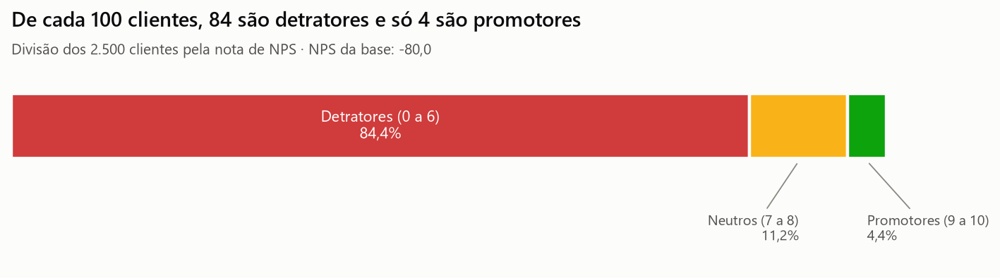
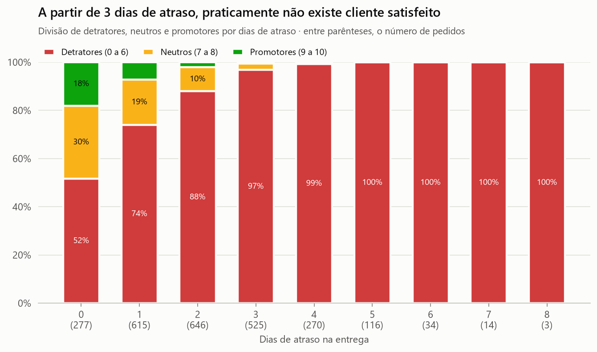
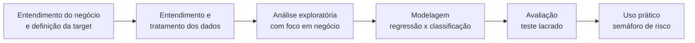

# NPS Preditivo · Tech Challenge Fase 1

Projeto do **Tech Challenge da Fase 1** da pós-graduação **AI Scientist (POSTECH)**. Ele investiga
quais fatores operacionais de um e-commerce definem a satisfação do cliente e propõe um modelo que
**estima a nota de NPS de cada pedido antes da pesquisa**, para que a empresa aja enquanto ainda dá
tempo de recuperar o cliente.



## Objetivo

O NPS da empresa só é conhecido depois que a jornada de compra termina. O projeto responde:

1. **Quais fatores operacionais realmente influenciam a satisfação do cliente?**
   (análise exploratória com foco em negócio)
2. **É possível antecipar a nota de cada cliente antes da pesquisa e transformar isso em ação?**
   (modelo preditivo, desafio opcional)

## Principais resultados

- **NPS da base: -80.** 84% de detratores, 11% de neutros e 4% de promotores.
- **Quatro fatores operacionais explicam a nota:** atraso na entrega, reclamações, contatos com o
  atendimento e tempo de resolução. **Perfil do cliente e do pedido não fazem diferença** (região,
  idade, tempo de casa, valor, desconto, frete, parcelas).
- **O cliente pune a promessa quebrada, não a espera:** prazo total de 4 ou de 14 dias tem o mesmo
  NPS; o atraso leva a taxa de detratores de 52% a 100%.
- **Ponto de ruptura no 3º dia de atraso:** daí em diante, 97% a 100% dos clientes são detratores.
  38,5% dos pedidos já passam desse ponto.
- **Promotor volta a comprar:** 100% dos promotores recompraram em 30 dias; nenhum detrator voltou.
- **Modelo:** regressão linear (o modelo de menor erro entre os quatro testados). Erra em média
  **1,4 ponto** na nota (34% menos que o baseline) e separa detratores com ROC-AUC de 0,87. Na faixa
  de risco **Crítico**, 100% dos clientes do teste viraram detratores.
- **Cada dia de atraso custa 0,94 ponto na nota.** Limitar o atraso a 2 dias levaria a nota média
  prevista de 4,4 para 5,0.



Detalhes em [`reports/02_resumo_executivo.md`](reports/02_resumo_executivo.md).

## Entregáveis

| Requisito do desafio | Onde está |
|---|---|
| 1. Entendimento do negócio | [`reports/01_entendimento_negocio_e_target.md`](reports/01_entendimento_negocio_e_target.md) |
| 2. Definição da target | [`reports/01_entendimento_negocio_e_target.md`](reports/01_entendimento_negocio_e_target.md#2-definição-da-target) |
| Tratamento e preparação dos dados | [`notebooks/01_tratamento_dados.ipynb`](notebooks/01_tratamento_dados.ipynb) e [`src/data_prep.py`](src/data_prep.py) |
| 3. Análise exploratória (EDA) | [`notebooks/02_analise_exploratoria.ipynb`](notebooks/02_analise_exploratoria.ipynb) |
| 4. Modelo preditivo e pipeline | [`notebooks/03_modelo_preditivo.ipynb`](notebooks/03_modelo_preditivo.ipynb), [`src/modeling.py`](src/modeling.py), [`src/train_model.py`](src/train_model.py) e [`src/predict.py`](src/predict.py) |
| Storytelling e recomendações | [`reports/02_resumo_executivo.md`](reports/02_resumo_executivo.md) |
| Roteiro dos slides e do vídeo | [`reports/03_roteiro_slides_e_video.md`](reports/03_roteiro_slides_e_video.md) |
| Apresentação (slides) | _adicionar o link_ |
| Vídeo executivo | _adicionar o link_ |

## Base de dados

Arquivo `desafio_nps_fase_1.csv`, disponibilizado no
[repositório do curso](https://github.com/AnaRaquelCafe/POSTECH_AI_SCIENTIST/tree/main/Base%20de%20dados%20Tech%20Challenge)
e copiado sem alterações para [`data/raw/`](data/raw/). São **2.500 pedidos, um por cliente**, e
19 colunas:

| Grupo | Colunas |
|---|---|
| Identificação | `customer_id`, `order_id` |
| Cliente | `customer_age`, `customer_region`, `customer_tenure_months` |
| Pedido | `order_value`, `items_quantity`, `discount_value`, `payment_installments` |
| Logística | `delivery_time_days`, `delivery_delay_days`, `freight_value`, `delivery_attempts` |
| Atendimento | `customer_service_contacts`, `resolution_time_days`, `complaints_count` |
| Pós-compra | `csat_internal_score`, `repeat_purchase_30d` |
| **Target** | `nps_score` (0 a 10, coletada após a experiência de compra) |

**Qualidade:** sem nulos, sem duplicados e sem valores impossíveis. 405 linhas (16%) têm
inconsistências entre colunas (ex.: atraso maior que o prazo total). Elas foram **mantidas e
sinalizadas** com colunas `flag_*`, porque a análise de sensibilidade mostrou que não mudam as
conclusões.

A base tratada fica em [`data/processed/nps_tratado.csv`](data/processed/nps_tratado.csv).

## Metodologia

O projeto segue as etapas do **CRISP-DM**:



1. **Entendimento do negócio e da target:** problema, importância do NPS, áreas beneficiadas,
   escolha da variável alvo e riscos de uso inadequado.
2. **Tratamento:** validação do esquema, diagnóstico de qualidade, faixas válidas, regras de
   consistência entre colunas, limpeza conservadora e análise de sensibilidade.
3. **EDA com foco em negócio:** correlação de Spearman, taxa de detratores por faixa, pontos de
   ruptura encontrados com árvore de decisão rasa, testes de Mann-Whitney, qui-quadrado e
   Kruskal-Wallis. Cada gráfico vem com uma "leitura para a operação" em linguagem simples.
4. **Modelagem:**
   - **Target:** `nps_score` (regressão de 0 a 10).
   - **Entradas:** só o que é conhecido antes da pesquisa. `csat_internal_score` e
     `repeat_purchase_30d` foram **excluídas por vazamento** (são posteriores à pesquisa ou outra
     medida de satisfação). Os IDs também ficam de fora.
   - **Preparação dentro do pipeline:** mediana para nulos, padronização das numéricas e one-hot da
     região.
   - **Separação:** 80% treino / 20% teste, estratificada pela categoria NPS. Validação cruzada em
     5 partes no treino para escolher o modelo; o teste é usado uma única vez.
   - **Modelos comparados:** baseline, regressão linear, random forest e gradient boosting (e as
     versões de classificação, como comparação).
   - **Avaliação:** MAE, RMSE e R² para a nota; ROC-AUC para a capacidade de separar detratores; taxa
     real de detratores por faixa de risco.
5. **Uso prático:** a nota prevista vira uma faixa de risco (Crítico, Alto, Atenção, Potencial
   promotor) com ação recomendada, fator principal e área responsável por pedido.

## Estrutura de pastas

```
.
├── data/
│   ├── raw/                  # base original do desafio (sem alterações)
│   └── processed/            # base tratada, gerada por src/data_prep.py
├── models/
│   ├── nps_regressor.joblib  # pipeline treinado (preparação + modelo)
│   └── metrics.json          # métricas de validação cruzada e de teste
├── notebooks/
│   ├── 01_tratamento_dados.ipynb
│   ├── 02_analise_exploratoria.ipynb
│   └── 03_modelo_preditivo.ipynb
├── reports/
│   ├── figures/              # gráficos usados nos notebooks e nos slides
│   ├── 01_entendimento_negocio_e_target.md
│   ├── 02_resumo_executivo.md
│   ├── 03_roteiro_slides_e_video.md
│   └── pedidos_priorizados.csv   # exemplo de saída do modelo
├── src/
│   ├── config.py             # caminhos, grupos de colunas e regras do NPS
│   ├── data_prep.py          # tratamento e preparação
│   ├── visualization.py      # padrão visual dos gráficos
│   ├── modeling.py           # pipelines, comparação, avaliação e faixas de risco
│   ├── train_model.py        # pipeline de treino (gera models/)
│   └── predict.py            # aplica o modelo e gera a lista priorizada
├── requirements.txt
└── README.md
```

## Como reproduzir

Requisitos: **Python 3.10 ou superior** e Git.

```bash
git clone https://github.com/lopeslyra10/tech-challenge-nps-preditivo.git
cd tech-challenge-nps-preditivo
python -m venv .venv
```

Ative o ambiente virtual:

```bash
# Windows (PowerShell)
.venv\Scripts\Activate.ps1
# Linux / macOS
source .venv/bin/activate
```

Instale as dependências e rode o pipeline completo:

```bash
pip install -r requirements.txt
python -m src.data_prep      # 1. trata a base e grava data/processed/nps_tratado.csv
python -m src.train_model    # 2. compara modelos, avalia no teste e grava models/
python -m src.predict        # 3. gera reports/pedidos_priorizados.csv
```

Para pontuar outro arquivo de pedidos (mesmas colunas da base; a nota de NPS não é necessária):

```bash
python -m src.predict --input caminho/pedidos.csv --output caminho/saida.csv
```

Para explorar a análise passo a passo, abra os notebooks na ordem (01, 02 e 03):

```bash
jupyter notebook notebooks/
```

Os notebooks e os scripts usam as mesmas funções de `src/` e a mesma semente aleatória (`42`),
então os resultados são sempre os mesmos. Versões usadas na execução publicada: Python 3.13,
pandas 3.0, numpy 2.5, scikit-learn 1.9, statsmodels 0.15, scipy 1.18 e matplotlib 3.11.

## Limitações

- A base tem sinais de dados simulados (variáveis sem correlação entre si e distribuições
  uniformes). As conclusões precisam ser revalidadas com dados reais.
- Não há data nem histórico do cliente, então não é possível fazer validação temporal.
- O modelo explica cerca de metade da variação da nota (R² 0,51 no teste) e identifica mal os
  promotores. Por isso o uso recomendado é por faixas de risco.
- Associação não é causa: os ganhos estimados na simulação devem ser confirmados com teste A/B.
- O modelo **não** deve ser usado para decidir quem recebe a pesquisa de NPS.

## Integrantes

| Nome | RM |
|---|---|
| Abiodun Victor Bamiro | RM378590 |
| Augusto Lopes Lyra | RM377121 |
| Roberto de Assis Marquini | RM378600 |
| Vinícius Caetano de Assis | RM378521 |
